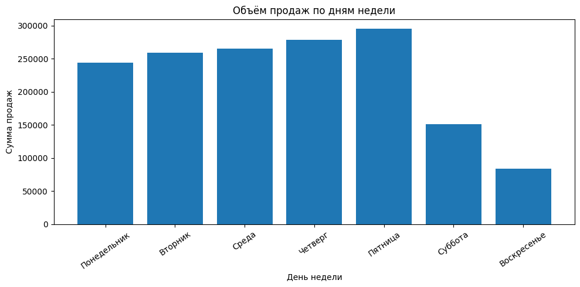
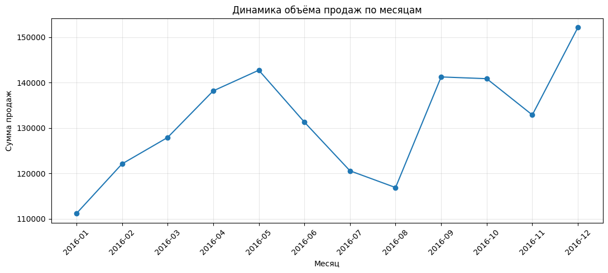
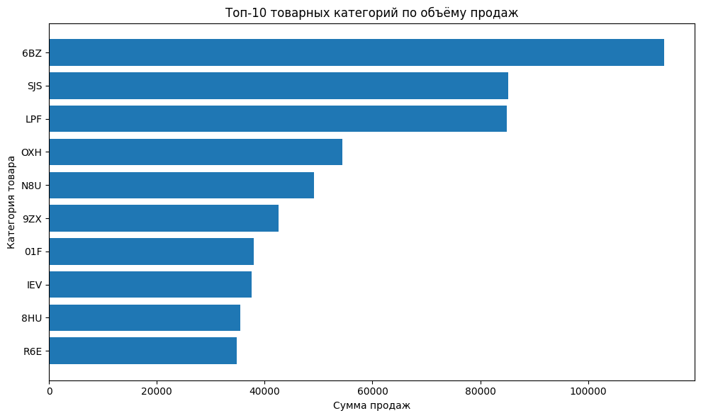

### 🛒 анализ продаж розничного магазина · retail sales analytics

разбираю год продаж магазина: проверяю качество данных, считаю ключевые метрики, ищу закономерности и делю покупателей на сегменты. на выходе выводы для бизнеса и готовый датасет для дашборда в yandex datalens
*a year of retail transactions: data quality check, kpis, sales patterns and customer segmentation, plus a clean dataset for a yandex datalens dashboard*

`python` `pandas` `matplotlib` `scikit-learn` `k-means` `yandex datalens`

📓 [открыть ноутбук · open the notebook](sales_analysis.ipynb)

---

**данные** · *data*

131 706 строк продаж за 2016 год: дата, покупатель, чек, категория и товар, количество и сумма. пропусков и дублей нет, техническую колонку-индекс убрала
*131,706 sales rows for 2016: date, customer, receipt, category, product, quantity and amount. no missing values or duplicates; a technical index column was dropped*

| метрика · metric | значение · value |
|---|---|
| выручка · revenue | 1 578 039 |
| чеков · transactions | 64 682 |
| покупателей · customers | 22 625 |
| категорий · categories | 187 |
| средний чек · avg receipt | 24.40 |

---

**что нашла** · *key findings*

**1. 31% покупателей приносят 81% выручки**
кластеризация разделила клиентов на два сегмента. ценные покупают в 4 раза чаще и тратят в 9 раз больше. им стоит программа лояльности, остальным напоминания и стимул вернуться
*31% of customers bring 81% of revenue. high-value customers buy 4× more often and spend 9× more: a loyalty program for them, win-back offers for the rest*

| сегмент · segment | покупателей · customers | доля выручки · revenue share | среднее на клиента · avg per customer | чеков · avg receipts |
|---|---|---|---|---|
| высокая ценность · high value | 7 020 (31%) | 80.9% | 181.87 | 6.1 |
| низкая активность · low activity | 15 605 (69%) | 19.1% | 19.31 | 1.4 |

число кластеров выбрала по silhouette score: для двух он максимальный (0.43)
*the number of clusters was chosen by silhouette score, which peaks at k = 2 (0.43)*

**2. магазин живёт по будням**
85% выручки приходится на понедельник–пятницу, пик в пятницу. в воскресенье продаж в 3.5 раза меньше, чем в пятницу. похоже на магазин рядом с офисами, и это стоит учитывать в графике смен и поставках
*85% of revenue comes on weekdays, peaking on friday; sunday sales are 3.5× lower. looks like a store near offices, which matters for staff shifts and deliveries*



**3. летний провал и пик в декабре**
продажи растут с января по май, проседают в июле–августе и выходят на максимум года в декабре (+37% к январю)
*sales grow from january to may, dip in july–august and peak in december (+37% vs january)*



**4. одна категория заметно впереди**
категория 6BZ даёт 7% всей выручки при 187 категориях, отрыв от второй больше 30%
*category 6BZ alone brings 7% of revenue out of 187 categories, over 30% ahead of the runner-up*



---

**как устроен анализ** · *pipeline*

1. **качество данных** · *data quality*: типы, пропуски, дубли, уникальные значения, проверка дат
2. **новые поля** · *feature engineering*: цена за единицу, месяц, день недели
3. **метрики и срезы** · *kpis & slices*: сводная таблица «категория × месяц», динамика, дни недели
4. **сегментация** · *segmentation*: для каждого покупателя сумма, число чеков, товаров и категорий, средний чек, давность покупки → логарифм → стандартизация → mini-batch k-means
5. **экспорт** · *export*: очищенный csv для yandex datalens и таблица покупателей с сегментами

---

**как запустить** · *how to run*

```bash
pip install -r requirements.txt
jupyter notebook sales_analysis.ipynb
```

положите `scanner_data.csv` в папку [`data/`](data/). в google colab ноутбук сам попросит загрузить файл
*put `scanner_data.csv` into [`data/`](data/). in google colab the notebook asks you to upload it*

---

учебный проект по курсу бизнес-информатики, мтуси. в методичке предлагался loginom, я сделала все этапы на python
*a university project; the course suggested loginom, i built every step in python instead*
